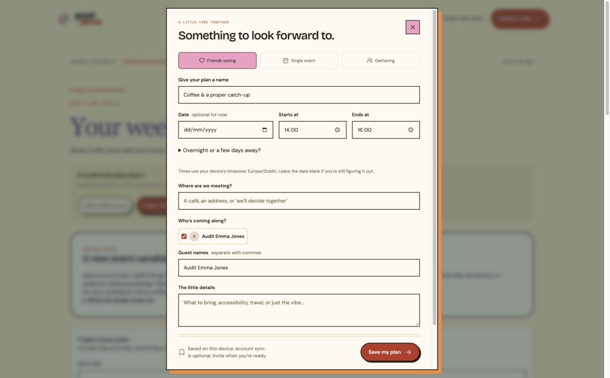
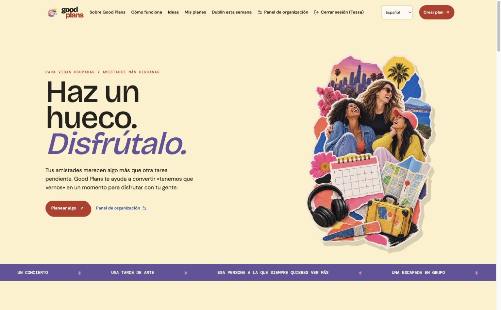
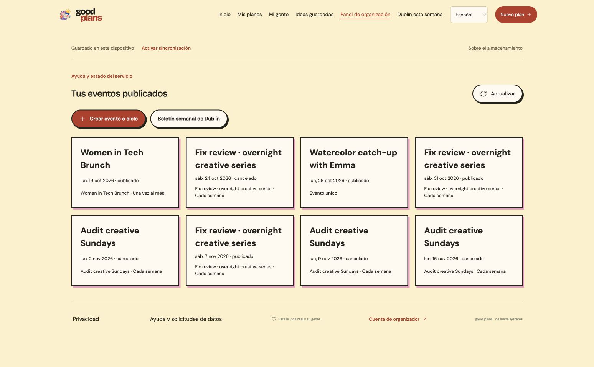
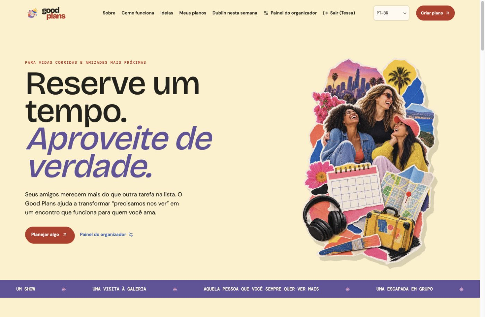
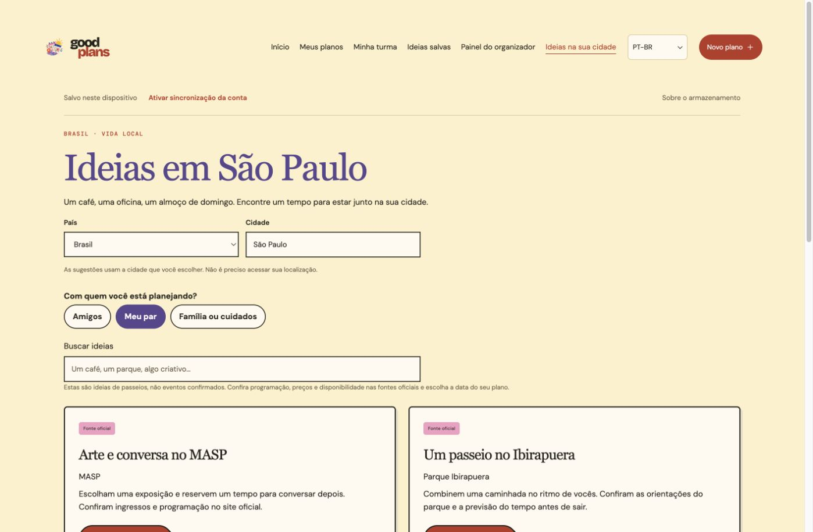
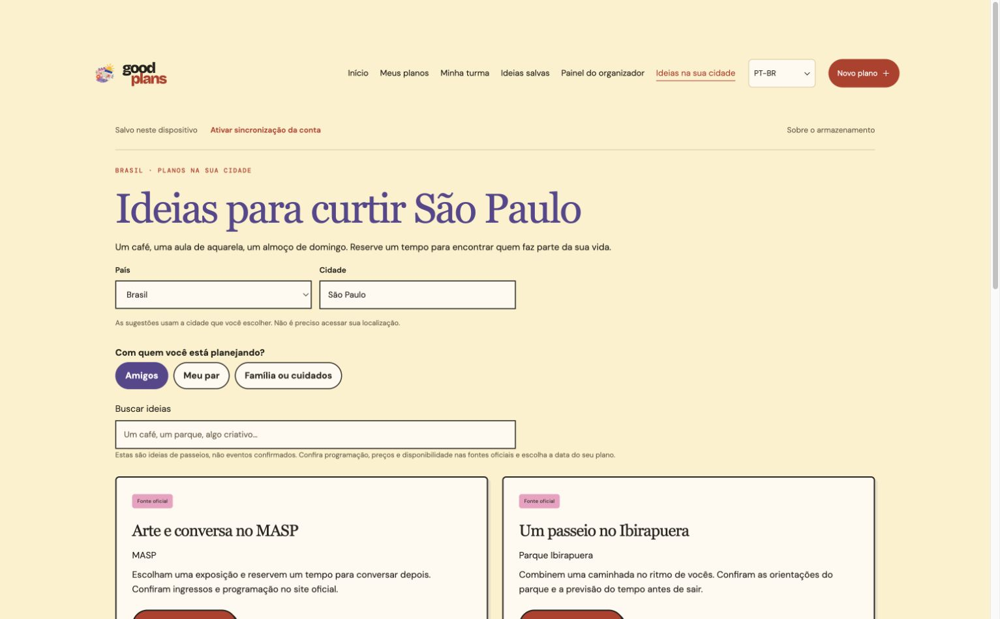

# Good Plans follow-up fixes

12 October 2026. Addresses GP-18–GP-30 from [the audit](./AUDIT-2026-10-12.md). Preserves the original cream, coral, pink and scrapbook artwork. Planning stays local unless the user explicitly enables account sync. Only hosts publishing invitations need authentication.

## Changes

| Issues | Result |
| --- | --- |
| GP-18, GP-19 | Publishing refreshes the portal and projects every series occurrence into My plans and the diary. Matching uses remote IDs and consumes the original draft once. Server-only events are included; unrelated local drafts remain. Guest names and response counts refresh from the host API. |
| GP-20 | Each invitation gets an HttpOnly session cookie. Read/reply requests carry an invitation identifier, validated against the session and event. Missing or unowned response contexts fail closed. Tokens are exchanged and removed from the URL; only the non-credential invitation identifier is kept in tab storage/memory for recovery. Hash changes and Back/Forward reload the invitation context. |
| GP-21, GP-30 | Form hints and inactive options use the accessible muted token; optional labels are 12px. Navigation uses links with aria-current; RSVP buttons expose aria-pressed and explicit current-response text. |
| GP-22 | Friend plans start with the everyday fields. Invitations, guest limit, emails and recurrence sit behind a disclosure. Save stays visible during scrolling; invalid hidden fields expand before browser validation focuses them. |
| GP-23 | Stable guest records associate email with an ID. Typed names deduplicate case-insensitively. Saved friend IDs carry renames into unpublished drafts; published invitation names remain historical. Legacy name-keyed emails migrate when saving. |
| GP-24 | Responses refresh event/guest data. Returning to an invitation refreshes it. Cancellation disables response/calendar actions and retains response history without suggesting it can be changed. |
| GP-25 | Optional end dates flow through personal forms, imports, publication, invitations and ICS/Google calendar. Imported timestamps preserve ambiguous DST instants; ongoing retreats appear as upcoming and occupy each relevant diary day. |
| GP-26, GP-27 | URLs identify plan detail, hosted occurrence, operations/newsletter view and edition. Refresh restores context; Back/Escape close the current plan. Counts match the filtered/searched list, and saving switches to a filter that reveals the plan. |
| GP-28, GP-29 | Host lists distinguish loading, load error and a successful empty response. Discovery copy reflects its connection and latest recorded daily collection; disconnected collection is disabled and manual event entry is open. |

## Validation

- `npm test`: 35 passing tests. New regressions cover all series dates without duplication, server-only events, current guest/count projection, friend renaming/email preservation, route context, overnight Dublin DST, repeated-hour source instants and diary date coverage.
- `npm run test:integration`: three passing isolated Worker/D1 journeys. Existing host and newsletter journeys remain covered. The new shared-browser journey exchanges two invitations into one cookie jar, reads/replies as each intended guest, rejects missing/unowned contexts and verifies persisted identities/counts. It also creates and reads an overnight event across the Dublin clock change.
- Production build to `/tmp/good-plans-fixes-2026-10-12` succeeds. Assets: 352.14 KB JS (105.81 KB gzip), 111.53 KB CSS (22.67 KB gzip). User-owned `dist/index.html` and `.claude/` were not edited.
- Chrome, same-origin isolated preview at port 8793: friend-selected draft, duplicate typed names, renaming, save, plan URL refresh, Back/Escape, overnight dates, three weekly occurrences, publication and direct Manage handoff, host URL refresh, all three dates in My plans, two guest tabs, plus-one/capacity waitlist, same-event new invite hash, host edit and refreshed guest data, cancellation/history copy, disconnected newsletter guidance, prepared edition and edition refresh.
- Native validation exposes an invalid guest limit even after its disclosure is closed; correcting it allows saving. Save is fully inside the dialog viewport. Form placeholder/optional/inactive text measured `rgb(107,96,72)` on `rgb(255,250,240)`, contrast **5.95:1**.
- Test records are fictional. No real emails or production changes were made. No commit, push or deployment occurred in this fixes pass.

## Remaining release work

[REL-01–REL-09](./BACKLOG.md) remain open: production deployment and real-domain flows, reviewed discovery content/authorised feed, Resend delivery callbacks, approved newsletter smoke test, independent-browser sync, operational ownership/restore drill and the pilot/public signup boundary.

The in-app browser did not become controllable. Chrome desktop validation worked, but its requested viewport override did not apply: DOM dimensions remained **1548×959**. Phone, tablet, 200% zoom and full keyboard coverage are explicitly unfinished, rather than claimed as passing. No production launch-readiness claim is made.

Deploy frontend assets and Worker together: updated RSVP requests require the invitation ID. Previously open client pages need a refresh to use the updated client; existing session cookies can still recover the intended invitation when validated.

## Compact design follow-up

The subsequent size/alignment request is implemented as GP-31. Default planner is 480×609 in the tested desktop view, with a 720px expand mode that preserves the draft. Optional date/time and notes are folded, backdrop is cream, workspace/settings spacing is reduced, and home/dashboard navigation centres align. A local save with date, selected friend and notes still works. Build and 35 existing unit tests pass; this does not close device or production verification. See [compact planner](./screenshots/compact-planner-2026-10-12.jpg) and [aligned navigation](./screenshots/aligned-nav-2026-10-12.jpg).

## Compact navigation and Spanish follow-up

GP-32–34 add a smaller, single-surface navigation create action, remove the duplicate topbar action, and separate event/series and newsletter controls with 12px spacing and phone stacking. A persistent English/Español selector is available in navigation and open plan panels, plus sign-in/privacy/support screens. The active application copy, accessibility labels, dates, weekdays, categories, copied invitations and generated planning explanations are localised. Spanish free-text interests are recognised without changing stable category IDs.

Language switching keeps unfinished input, friend selection, route identifiers and private invitation hashes. Dropdown display labels translate while stored values and payloads remain canonical. Personal/external event content is kept in its original language. Newsletter editions and server-generated email content retain their existing authoring/delivery language.

Verification: 38 unit checks and a temporary production build pass. Browser language-switch/save journey passed with fictional local data; privacy/support navigation retains Spanish. Actual viewport overrides worked in this follow-up: 320/390px homepage, organiser, newsletter editor and planner layouts; 768px organiser layout. Native date-field and homepage-select overflow were found and fixed. Full keyboard, physical-device, zoom and production checks remain under REL-09. No production changes, email sends, commit or push.

## Brazilian Portuguese follow-up

GP-35 extends the existing language system with Português (Brasil). The menu uses a compact PT-BR display, keeping the full language name in the native dropdown and accessibility tree. Brazilian Portuguese covers the same 919 interface strings as Spanish, with Brazilian date/weekday formatting, copied invitation scaffolding, document metadata and Portuguese free-text interest matching.

Language changes preserve draft input, selected friends, URL context, private invitation hashes and canonical request values. Full-page app links now carry the language independently of local storage. Personal notes, interests, custom activity names, venue names and source prices render verbatim; stock interface defaults still translate. Event currency and timezone follow the event. Source listings, authored newsletter content and server-generated delivery emails keep their existing language.

Verification: all 42 unit checks and a temporary production build pass. Browser Portuguese → English → Portuguese kept an open draft and selected friend; local save succeeded. Reload, privacy and support navigation retained Portuguese. Checked 320px navigation/editor/organiser and 390px newsletter/support without page overflow in these states; confirmed native dropdown payloads remain canonical. No production writes, email sends, commit or push. Remaining device/production checks stay in REL-09.

## Brazil regional experience

GP-36 responds to the clarification that this should support local life in Brazil. The country/city picker is available on the homepage, local discovery and planning settings. Portuguese defaults to São Paulo when no country has been explicitly chosen; an explicit region persists independently of interface language. Existing personal records are preserved. Example friends are Ana, Camila, Joana, Beatriz and Mariana; starter activities include aquarela, a café na padaria, board games, park walks and a Sunday lunch.

Official venue starter ideas are scoped to São Paulo and Rio de Janeiro. Other cities have adaptable, undated outing ideas. Source links point to MASP, Ibirapuera, Sesc's programme, Pinacoteca, Jardim Botânico and Museu do Amanhã. The UI labels them as ideas and asks people to check programme, price, availability and accessibility. Partner and family/caregiving choices carry into editable draft notes. No dates, tickets or prices are invented. The Dublin newsletter action is hidden for the Brazil region; no automatic Brazil event feed/newsletter is connected. GP-37 and GP-38 track authorised sources, wider curation and localised delivery emails.

Brazil budgets and new draft costs use R$. City presets cover Brazil's four UTC offsets, and event timezone can be chosen explicitly, including when a typed city is not in the preset list. Shared timezone conversion preserves event wall times in calendar exports, publication, recurring series, host editing and projected invitations even when the browser is outside Brazil. Copied invitations include the timezone. Existing imported instants are preserved; language/region changes do not rewrite saved events. Host-list dates now use each event's timezone.

Verification: 46 unit checks and all three isolated backend integration journeys pass. The temporary production build succeeds (513.66KB JS / 161.16KB gzip; a >500KB chunk warning remains under GP-39). Chrome verified São Paulo → Rio → Manaus suggestions, Brazil → Ireland → Brazil switching, language changes preserving the selected country/city, and a MASP idea → editable draft → fictional partner Pedro → local save with R$30 on 25 October at 14:00 São Paulo. The Google Calendar link correctly uses 17:00 UTC and invitation text includes America/Sao_Paulo. Home examples/maps use São Paulo venues; no Google map loads automatically. Actual 320px checks covered local discovery, planner, saved plan detail, My plans, homepage and organiser portal. Found and fixed the Portuguese My plans tabs widening the page. No console errors were captured in this browser check.

This is local implementation and verification, not production activation. No real emails, production database writes, commit, push or deployment occurred. User-owned dist/index.html and .claude/ remain untouched. REL-01–09 remain open.

## Brazilian Portuguese editorial review

GP-40 reviews the Portuguese interface and Brazilian sample content for translation pitfalls and presentation clarity. “Oficina” is valid for a hands-on workshop, but main leisure suggestions now use clearer “aula” or “atividade criativa” wording. Sesc remains a programme to check rather than a claimed scheduled class. Corrected awkward marketing phrases, the audience line, the suggested time-window label and “parede de resultados”; hid the Worker implementation term in the Portuguese organiser guidance. Personal notes, stored activities, external event titles and canonical category values are preserved.

The [creator review document](./REVISAO-PT-BR-APRESENTACAO.md) includes key screen copy, translation distinctions, optional choices for “Meu par”/family-caregiving labels, and a demo sequence. It distinguishes currently available local planning from the unconnected Brazil feed/newsletter and untranslated server email templates. Creator editorial approval is not implied.

Verification: all 46 existing unit checks and a temporary production build pass (513.81KB JS / 161.22KB gzip; the bundle warning remains under GP-39). Chrome at 320px verified the revised ideas page and creative-class suggestion opening a draft with the revised title/notes and no invented date. No page overflow or console errors were observed. No production changes, real mail, commit or push occurred. Existing dist/index.html and .claude/ remain untouched.

# Material dropdowns and regional discovery follow-up

- Added the official Material Web outlined select through a shared React adapter across language, country/timezone, planner, settings, discovery category, support and newsletter fields. Navigation fields retain 44px targets; form fields are 48px. Menus use top-layer popovers, with keyboard navigation/typeahead and reduced-motion support. Translated option text and the selected display refresh together without changing canonical form values.
- Language no longer infers country. Explicit location settings and legacy recognised cities remain stable. Brazil editorial suggestion titles/descriptions now render in English, Spanish or Portuguese; official names and personal content remain as supplied.
- Added Spain after the creator selected it as the next region: mainland/Canary Islands timezones, euros, configurable cities, fictional example friends and verified official Madrid/Barcelona programme links. General ideas are available elsewhere. All regional starter ideas remain undated, with no invented availability/prices.
- Browser verification: Spanish kept São Paulo; choosing Spain loaded Madrid; a Prado idea opened a Spanish draft with the correct venue/source and Europe/Madrid timezone. Inside the planner, Escape closed the timezone menu while retaining the dialog. Arrow/End/Enter language selection worked. Portuguese retained Spain/Madrid and refreshed España to Espanha immediately. A Canary Islands city retained its region while changing language.
- Browser verification: navigation/menu/discovery at 320px had page width 305px; 768px had page width 753px. Desktop preview inspected. A fictional local support request submitted the Material field through real FormData; local D1 confirmed canonical kind `export`, with no external email. No console errors observed.
- Validation: 48 unit checks pass, temporary production build passes, and `git diff --check` passes. Split Material (137.94KB), translations (149.54KB), and application (379.57KB) chunks remove the 500KB chunk warning. Combined initial JavaScript remains about 668KB / 198KB gzip; slower-device performance remains open.
- [Preview](./screenshots/material-dropdowns-2026-10-12.jpg). [Live-feed implementation plan](./REGIONAL-EVENT-DISCOVERY.md). GP-41–43 are implemented locally; GP-37/44 and regional live-newsletter activation remain open. No commit, push, deployment, production database write or real email send in this follow-up. User-owned `dist/index.html` and `.claude/` remain untouched.

## Launch city scope follow-up

Brazil discovery is restricted to São Paulo and Spain to Barcelona. Defaults, city menus, starter listings, presentation copy and the future live-feed plan follow that scope. Historical timezone helpers remain for existing plans; saved event records are not migrated or rewritten. Browser verified each city menu has one option and switching country loads the correct city/catalogue. All 48 unit checks and the temporary production build pass. No deployment, commit or push. [Preview](./screenshots/launch-cities-2026-10-12.jpg).

### Public launch scope — English and Dublin only

The creator has narrowed the visible release to English and Dublin. Language and country/city selectors are hidden. Existing saved plans retain their authored content, locations and timezones. Spanish, Brazilian Portuguese, São Paulo and Barcelona remain deferred; their dictionaries and catalogue work are kept for a later release. Regional source collectors and newsletters are not blockers for this Dublin release. English links and legacy translated URLs use the English interface; new planning defaults use Dublin, EUR and Europe/Dublin.

### Smaller homepage hero

Reduced the desktop collage from a maximum 425px to 240px wide, with 160px and 128px mobile sizes. Removed absolute positioning and tall reserved image space, tightened hero padding, and reduced its desktop height to 460px. Kept the original artwork, headline and planning actions. Responsive review also found the three-column About section overflowed at tablet widths; it now uses two columns there. Verified in Chrome at desktop, 390px, 320px and 768px; build and whitespace checks pass. Preview only, not deployed.
